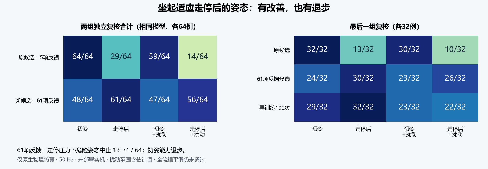
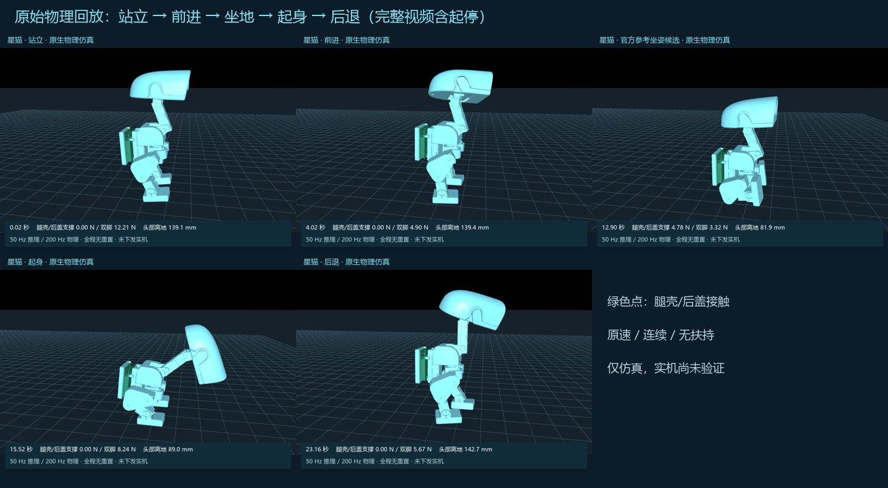

# 星猫夜间审查与重训结果 · 2026-10-26

**代码修复和多项完整模型重训已完成并留有对照；“1 m/s、全程丝滑、全部特技”没有完成，不能作为稳定实机版本交付。** 所有新候选仅在本机保存，未发布权重、未安装到小鸭子。夜间未发送实机动作、上力或解锁命令；用户最后确认在托盘卸力，随后无线断开，未冒充有新的 OFF 回执。

本报告使用截至北京时间 09:00 已结束的实验，供约定的 10:00 交付。完整过程和失败记录见 [夜间交接](OVERNIGHT_20261025.md)。下列数值均为原生 MuJoCo 物理仿真；此前校准后用户确认“原地站立，未扶”，属于另外一次实机结果，不能替代新模型验收。

**目前各项做到哪里**

| 用户目标 | 已完成的证据 | 尚未满足的部分 |
|---|---|---|
| 50 Hz 推理 | 20 ms 策略周期、10 ms 反馈、5 ms 物理步；完整动作链 28.14 秒 / 1407 次策略调用，中途零重置 | 本夜未在板端测新权重；PC 推理耗时不等于板端周期保证 |
| 方向键移动、松键停止 | 修正部署姿态/滤波基准后，完整演员重训；最佳六指令模型名义 24/24、假设压力 20/24 | 仍有压力案例失败，完整操作链的目标平滑门槛未过 |
| Shift 从 0.2 提至 1 m/s | 已做有界速度课程和全演员续训 | 0.6 m/s 指令的候选实际约 0.403–0.441 m/s，直线性未过；1 m/s 未达到。发布控制仍是原 0.3 m/s 档 |
| 坐下、起来 | 按官方 SitStand 关键姿态制作神经候选；初姿和真实走停入口均独立评测，见下表 | 约 1.90 秒落座、3.24 秒起身，另各保持 2 秒；不是瞬间“一屁股”。最终腿壳和脚支撑，未确认就是用户指定官方演示 |
| 丝滑衔接 | 修复模型内部非零/后退硬门；连续走停坐起后退完整链均保留原速记录 | 最后 8 例新场景全部走完，但整链平滑 0/8；头部目标跳变仍在，不能把完成动作称为丝滑 |
| 跳舞 | 从随机权重完整训练基础双脚支撑舞蹈，32/32 独立案例通过、连续 10 秒 | 仅摇头摆身，未实机验证，不含托马斯 |
| 翻跟头 | 完整翻滚演员重训；旧/新各 32/32 完成一圈再接共同 Walk 站稳 | 属于接地翻滚，不能等同腾空翻跟头；头仍碰地，降冲击门槛未全过，结构承载未验收 |
| 单脚、倒立、托马斯、头顶旋转 | 单脚做了静态支撑和自由动力学可行性搜索 | 单脚自由保持未成功；其余没有训练成功结果。Getup/Pick 全模型重训也未完成 |

**坐起的真实前后对比**

先前只从保存的站姿训练，忽略了“走过、停下”的实际关节姿态和历史。相同场景中，停下后俯仰从 −2.69° 变为 +2.78°，高度从 143.05 变为 138.31 mm；即使速度近零，进入条件也不同。修正教师读取实际动作起点，并让完整神经模型使用 61 项反馈，针对该差异重新采样、训练全部 26254 个演员参数。

以下为两组互不重叠的新种子，各条件 32+32 例；模型哈希保持不变，未混入训练集和选版本的验证集：

| 相同评测条件 | 原坐起候选（5 项反馈，PPO1000） | 新坐起候选（61 项反馈） |
|---|---:|---:|
| 初始站姿直接坐起 | 64/64 | 48/64 |
| 真正走停后坐起 | 29/64 | 61/64 |
| 初始站姿 + 假设物理扰动 | 59/64 | 47/64 |
| 真正走停 + 假设物理扰动 | 14/64 | 56/64 |
| 走停扰动中的危险姿态提前中止（越少越好） | 13/64 | 4/64 |

新版本对真实走停入口明显改善，但丢失了一部分初姿能力，**没有成为通用替换版本**。未通过的案例还包括倾角余量、静止和目标步进超限，不全部是倒地；危险姿态提前中止也单独记录。[汇总数据](../reports/overnight-20261025/sit-independent-combined-0900.json)、[第一组逐例数据](../reports/overnight-20261025/sit-entry-independent-0830.json)、[最后一组逐例数据](../reports/overnight-20261025/sit-final-independent-0900.json)。

最后再进行 500 次有界全参数 PPO，验证组挑出的第 100 次快照，在新的 32 例走停名义条件达到 32/32，但走停扰动从其父模型 26/32 退到 22/32，危险姿态中止由 3 增至 5；同一新完整链坐下 8/8 退到 7/8。因此拒绝晋升，保留全部失败记录，未用最后权重覆盖较好的旧版本。

**原速演示与实际支撑部位**

- 同一预先指定场景 9000 的完整连续链：[修改前 28.14 秒](../reports/overnight-20261025/official-entry-before-0830-native.mp4)、[61 项反馈候选 28.14 秒](../reports/overnight-20261025/official-entry-after-0830-native.mp4)。两条都含走、停、坐、起、后退、再停，中间没有重置或剪掉失败；单条完成不代表整组平滑通过。
- 初始站姿坐起候选：[9.14 秒原速](../reports/overnight-20261025/official-sit-ppo1000-native.mp4)、[五帧](../reports/overnight-20261025/official-sit-ppo1000-five-frames.png)。最后支撑为腿壳和双脚，后盖在转移过程中可能接触地面；不能把接触标签“seat”当成用户已经认可的屁股落地动作。官方 [SitStand 配置](https://github.com/LuwuDynamics/xgoduck_rl/blob/main/src/mjlab_microduck/tasks/microduck_sitstand_env_cfg.py) 是姿态参考，确切指定视频仍未确认。
- 基础舞蹈：[10 秒原速](../reports/overnight-20261025/supported-dance-native.mp4)、[五帧](../reports/overnight-20261025/supported-dance-five-frames.png)、[32 例指标](../reports/overnight-20261025/supported-dance-review.json)。
- 接地翻滚对照：[原模型](../reports/overnight-20261025/roll-baseline-native.mp4)、[全演员重训候选](../reports/overnight-20261025/roll-v2-native.mp4)、[五帧](../reports/overnight-20261025/roll-v2-five-frames.png)。名义头部力峰值 p95 从 41.30 降至 30.31 N，但平均冲量只减少 9.05%，未过预先设定的 10% 改善门槛；不能据此上实机。[逐例对照](../reports/overnight-20261025/roll-v2-review.json)。
- 未采用的最后 PPO100：[完整原速](../reports/overnight-20261025/official-entry-ppo100-0900-native.mp4)、[五帧](../reports/overnight-20261025/official-entry-ppo100-0900-five-frames.png)。另保留 [失败坐起视频](../reports/overnight-20261025/official-sit-entry-ppo-failed-native.mp4)，不会只交付最好看的片段。

**代码修复及验证**

1. 对齐当前已认可的髋 ±22°、踝 ±18°、颈/头 20°/20°，统一观测零点、动作零点和头腿滤波；修正把右髋当头部的旧训练分组。旧环境单独保留用于复现，未改名冒充新训练。
2. 找到 47500 复合网络的硬切换：同一姿态指令从 0 到 0.00001 m/s，原目标跳 19.6628°；连续条件结构后为 0.000239°。后退阈值附近从 1.4278° 降至 0.002168°，随后训练全部演员，未靠新增缓存遮盖。[可复核数据](../reports/overnight-20261025/continuous-gate-audit.json)。此修复不代表行走自身的跳变已解决。
3. 修复可选坐下权重缺失导致启动失败、旧固件轮询清掉新更新锁、更新结果未知时错误重放及更新期间允许校准。源码包不再强依赖未发布的本地坐下权重。
4. 修复仿真观测落后一个物理子步、把请求扭矩当实际限幅后扭矩的问题；头部接触按 200 Hz 子步记录。修复连续链提前失败却继续执行后续阶段、无导出结果时评测空等等错误。
5. 修正本轮教师包装器错误沿用初始关节角的问题，明确区分坐下实际入口与起身目标；新公共模块在两个完整案例共 914 周期与修正后的原教师动作一致，增加实际起点和每轮重读回归。受影响的旧数据、失败分支保留并标明，未悄悄覆盖。

有效验证记录：根目录 Python 199 项通过；公开导出副本 198 通过、1 项私有坐下权重测试跳过；Node 36 项通过；固件依赖 239 个锁定文件核验通过。后续新增训练模块最终 47 项通过，发布包检查 11 项通过。后续只修改文档与派生结果时复用仍有效的代码回归，包清单随提交重新核验。**这些是代码验证，不是机器人动作验收。**

**物理参数与训练范围**

XML SHA256：`c89d853c85d3b04ab2027cc2c413d48b95ad93aa002d064a3cc95b69954838af`。整机 826 g、电池 108 g、扩展板 20 g 为用户提供；主板 30 g、网格均匀密度惯量、电机 D20 映射仍有估计。压力范围含电压 7.2–8.1 V、摩擦 0.55–1.0、重心 ±1.5 mm、惯量 ×0.9–1.1、10–30 ms 传输延迟。它们是明确的测试假设，不能称所有参数已经实测。

行走、坐起和翻滚均做了全部演员参数训练，旧权重只作为初始化；基础舞蹈由随机权重训练。没有把冻结旧演员的残差包装叫作全模型重训；但也不能声称所有动作都已重训完成。失败的随机站立、高速、过强平滑代价和后期 PPO 退步版本均未发布。

**采用的架构与下一步顺序**

普通移动使用同一速度条件策略；坐起、翻滚等接触方式明显不同的动作先作为独立专家，所有衔接共享同一个物理状态、反馈、动作历史和延迟队列。模型数量不能保证顺滑，必须把整条键盘操作流程作为验收对象；当前这个验收仍失败。

继续推进时，应先解决行走头部目标跳变和初姿/走停入口两类能力同时保留，再核对用户指定的官方坐下形态。之后测清电机速度/力矩、质量分布等关键估计参数，重新跑同条件评测，达标后再在用户在场且明确离开托盘的条件下做有限实机验收。1 m/s 和高冲击特技排在基础闭环通过之后，不能靠改网页常量开放。

之前漏查的教训已经落入项目检查：先核对**实际部署构建**而非只看仓库代码；拆装后重新确认机械零位；读取原始舵机反馈而非仅看在线掩码；区分有无运动、是否持续后退、速度直线性和结束姿态；保留失败并用独立场景和原速画面决定版本。此前帧头修复未进入官方拆分固件、回正路径误走站姿就是这种部署核对不足，不应归咎用户的插头。
